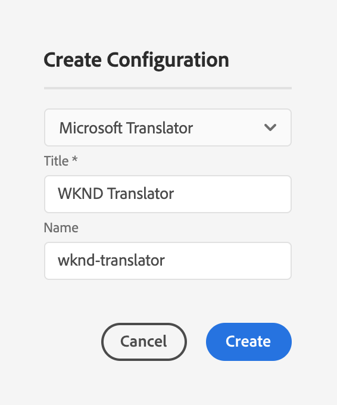
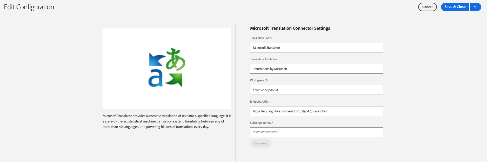

# Conectar ao Microsoft Translator {#connecting-to-microsoft-translator}

O AEM fornece um conector integrado para o [Microsoft Translator](https://www.microsoft.com/pt-br/translator/business/) para traduzir conteúdo ou ativos da página. Após obter uma licença do Microsoft para usar o Microsoft Translator, configure o conector seguindo as instruções nesta página.

| Propriedade | Descrição |
|---|---|
| Rótulo da tradução | O nome de exibição do serviço de tradução |
| Atribuição da tradução | (Opcional) Para conteúdo gerado pelo usuário, a atribuição que aparece ao lado do texto traduzido, por exemplo, `Translations by Microsoft` |
| ID do espaço de trabalho | (Opcional) A ID do mecanismo personalizado do Microsoft Translator a ser usado |
| Chave de inscrição | Sua chave de assinatura Microsoft para o Microsoft Translator |

O procedimento a seguir cria uma configuração do Microsoft Translator.

1. No [painel de navegação,](/help/sites-authoring/basic-handling.md#first-steps) clique em **Ferramentas** > **Serviços em Nuvem** > **Serviços de Tradução em Nuvem**.
1. Navegue até o local em que deseja criar a configuração. Normalmente, isso fica na raiz do site ou pode ser uma configuração global padrão.
1. Clique no botão **Criar**.
1. Defina sua configuração.
   1. Selecione **Microsoft Translator** no menu suspenso.
   1. Digite um título para sua configuração. O título identifica a configuração no console do Cloud Services bem como nas listas suspensas de propriedades da página.
   1. Opcionalmente, digite um nome a ser usado para o nó do repositório que armazena a configuração.

   

1. Clique em **Criar**.
1. Na janela **Editar configuração**, forneça os valores para o serviço de tradução descrito na tabela anterior.

   

1. Clique em **Conectar** para verificar a conexão.
1. Clique em **Salvar e fechar**.

## Publicar as configurações do serviço de tradução {#publishing-the-translator-service-configurations}

Como etapa final, publique as configurações do Microsoft Translator para oferecer suporte ao conteúdo traduzido publicado, usando a ação [publicar uma árvore](/help/sites-authoring/publishing-pages.md#publishing-and-unpublishing-a-tree).

## Mapeamento de campos da API do Microsoft Translator {#microsoft-translator-api-field-mapping}

A API v3 do Microsoft Translator aceita solicitações de tradução em `https://api.cognitive.microsofttranslator.com/translate?api-version=3.0`. Consulte a [Referência da API do Microsoft Translate](https://learn.microsoft.com/en-us/azure/ai-services/translator/text-translation/reference/v3/translate) para obter os parâmetros necessários, incluindo o idioma de destino.

A tabela a seguir relaciona os campos de configuração do AEM à API do Microsoft.

| Campo do AEM | Finalidade no AEM | Relacionamento da API do Microsoft |
|---|---|---|
| ID do espaço de trabalho | Identifica o mecanismo personalizado do Microsoft Translator a ser usado. | Os sistemas de tradução personalizados são selecionados por meio do parâmetro de solicitação `category`. A API do Microsoft espera uma ID de categoria do tradutor personalizado, não uma ID de espaço de trabalho sozinha. Confirme o valor exigido pelo conector e pela configuração de modelo personalizado. |
| Rótulo da tradução | Fornece um nome de exibição para o serviço de tradução. | Nenhum parâmetro de solicitação de tradução correspondente. |
| Atribuição da tradução | Define a atribuição opcional ao lado do conteúdo traduzido gerado pelo usuário. | Nenhum parâmetro de solicitação de tradução correspondente. |
| Chave de inscrição | Autentica o acesso à assinatura do Microsoft Translator. | Enviado no cabeçalho `Ocp-Apim-Subscription-Key` ao solicitar um token de acesso. O token é enviado no cabeçalho `Authorization: Bearer <access-token>` para solicitações de tradução. |

Para um recurso global do Microsoft Translator, o ponto de extremidade do token é `https://api.cognitive.microsoft.com/sts/v1.0/issueToken`. Os recursos regionais e de vários serviços usam endpoints de token específicos da região. Consulte [Autenticação do Microsoft Translator](https://learn.microsoft.com/en-us/azure/ai-services/translator/text-translation/reference/authentication) para obter os requisitos de ponto de extremidade e cabeçalho para o seu tipo de recurso.
